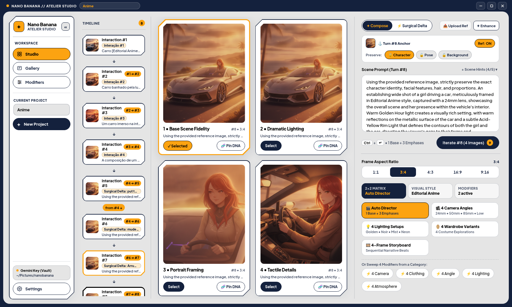

# Nano Banana Interactive Studio (`Tauri v2` + `React 19` + `Local SQLite`)

An installable Desktop & Web studio for creating and iteratively refining images with **Google's Nano Banana (`gemini-2.5-flash-image`)**, featuring a **Neo-Brutalist Editorial Anime UI** inspired by Crypko, a built-in **Rust / TypeScript Interactive Co-Pilot**, **Local SQLite (`rusqlite`)** persistence, and **Native OS Filesystem** image storage.



---

## Architecture Highlights

1. **Installable Native Desktop App (`src-tauri/`)**:
   - Powered by **Tauri v2** (Rust core + OS native WebView), producing a lightweight (~12 MB) native installer (`.deb`, `.AppImage`, `.dmg`, `.msi`).
   - Zero Docker / Podman / PostgreSQL / S3 container dependencies required.
2. **Local SQLite Persistence (`<app_data_dir>/nanobanana.sqlite3`)**:
   - Managed natively by `rusqlite` (bundled SQLite 3) in [`src-tauri/src/db.rs`](file:///usr/local/google/home/vieiravitor/workspace/opensource/nanobanana-inspiration/src-tauri/src/db.rs) with automatic fallback in [`tauriBridge.ts`](file:///usr/local/google/home/vieiravitor/workspace/opensource/nanobanana-inspiration/frontend/src/core/tauri/tauriBridge.ts) when running in browser dev mode.
   - Relational schema: `users`, `conversations`, `conversation_turns`, and `app_vault`.
3. **Native OS Filesystem Image Storage (`<app_data_dir>/images/`)**:
   - Every generated turn is saved directly to the user's local filesystem (`<app_data_dir>/images/<user_id>/<turn_id>.png`) via [`src-tauri/src/storage.rs`](file:///usr/local/google/home/vieiravitor/workspace/opensource/nanobanana-inspiration/src-tauri/src/storage.rs).
4. **Hybrid API Key Security (RAM-Only Default + Optional Local App Vault)**:
   - By default, your **Google Gemini API Key** lives strictly in volatile React RAM (`useState`).
   - Optionally, you can check **"Remember in Local App Vault (SQLite)"** in the Creation Studio (`/create`) to store the key locally in your desktop app's `app_vault` table so you don't need to re-enter it on every launch.

---

## Quick Start

### 1. Run in Local Development Mode (`http://localhost:8080`)

```bash
npm --prefix frontend install
npm run dev
```

Open **`http://localhost:8080/`** in your browser. All 4 routes (`/`, `/gallery`, `/login`, `/create`), the Co-Pilot engine, profile editing modal, and local SQLite/storage bridge work out of the box without any external containers.

### 2. Run & Build the Installable Tauri v2 Desktop App

#### Prerequisites (Linux / Debian / Ubuntu)
Install the Rust toolchain (`rustup`) and WebKit2GTK system headers:

```bash
curl --proto '=https' --tlsv1.2 -sSf https://sh.rustup.rs | sh
sudo apt-get update && sudo apt-get install -y \
  libwebkit2gtk-4.1-dev \
  build-essential \
  curl \
  wget \
  file \
  libxdo-dev \
  libssl-dev \
  libayatana-appindicator3-dev \
  librsvg2-dev
```

#### Launch Native Desktop Window (Dev)
```bash
npm run tauri:dev
```

#### Build Native Installers (`.deb`, `.AppImage`, `.dmg`, `.msi`)
```bash
npm run tauri:build
```
The compiled installers are generated in `src-tauri/target/release/bundle/`.
