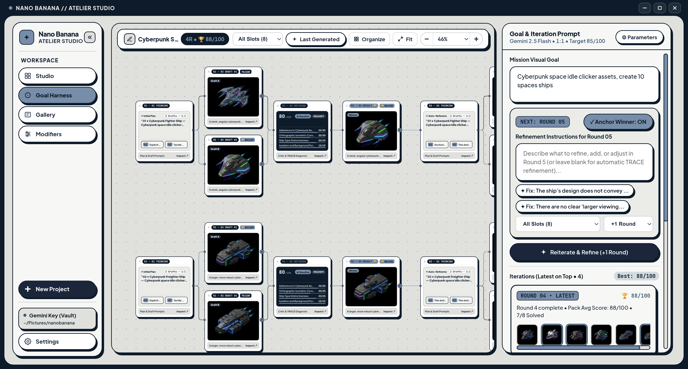
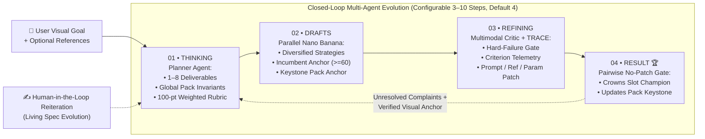

# Nano Banana Goal Harness & Atelier Studio 🍌✦

> **Autonomous Multi-Agent Image Evolution Harness (`AutoRef + EvoGen TRACE`) & Interactive 2×2 Studio for Google Nano Banana (`gemini-2.5-flash-image` & `gemini-3-pro-image-preview`)** — built with **Tauri v2 (Rust)**, **Next.js 15 / React 19**, and **Local SQLite**.


*Above: **Cyberpunk Space Idle Clicker Ships Pack** evolving autonomously in the Goal Harness — decomposing a single prompt into 8 cohesive isometric spaceship slots, generating parallel drafts per slot, scoring against a 100-point rubric via a Multimodal Critic, and refining across rounds via TRACE attribution.*

---

## Why This Repository Exists: An Agentic Harness for Nano Banana

**Google Nano Banana (`gemini-2.5-flash-image` and `gemini-3-pro-image-preview`)** is fast and expressive, yet single-shot image prompting struggles when a project demands **strict multi-asset cohesion** (e.g., an 8-ship isometric game asset pack), **zero cropped silhouettes**, or **10+ rounds of evolving art direction** without prompt amnesia.

This repository demonstrates how to wrap **Nano Banana** inside a **closed-loop, multi-agent Goal-Driven Harness** that plans, renders, critiques, diagnoses root causes, and iteratively evolves visual deliverables until they meet a target quality threshold—visualized live on an infinite Left-to-Right node canvas.

---

## How the Goal Harness Thinks & Evolves (`01` ──► `02` ──► `03` ──► `04`)

Every round in `/harness` executes a 4-stage closed loop inspired by **AutoRef-Harness** (*Explicit Reference Role Allocation, Hard-Failure Gate, Pairwise Judge, Complaint-Directed Revision*) and **EvoGen-Harness** (*TRACE — Trajectory-Relative Attribution and Coordinated Evolution*):



### 1. `01 • THINKING` — Decomposition, Invariants & Role Allocation
- **Single Asset vs. Multi-Asset Pack**: `runHarnessPlannerAgent` (`gemini-2.5-flash`) determines whether your goal is a single hero frame or a cohesive multi-asset pack (up to **8 deliverables** in parallel horizontal swimlanes, as shown in the *Cyberpunk Space Idle Clicker Ships Pack* above).
- **Global Pack Invariants**: Establishes strict shared rules enforced across every slot (e.g., *30° orthographic isometric 2:1 camera, top-left warm key light + cyan neon rim, centered uncut silhouette, clean dark-slate isolation*).
- **Explicit Reference Role Allocation**: Assigns non-overlapping roles to user reference images (*Identity & Subject Anchor* vs. *Style & Projection Anchor*).
- **100-Point Weighted Rubric**: Generates 4 domain-specific evaluation criteria whose weights sum to `100`.

### 2. `02 • DRAFTS` — Parallel Nano Banana Rendering & Smart Reference Routing
- Generates multiple candidate variations in parallel per slot using distinct optical/spatial strategies.
- **Conditional Incumbent Anchoring (`Score >= 60` Rule)**: Feeds the prior round's winning image back into Nano Banana as `Reference #1` *only* if it scored $\ge 60/100$. Low-scoring compositions ($< 60$) are discarded so the next round isn't trapped in a broken layout.
- **Keystone Pack Anchor**: In multi-asset packs, the highest-scoring verified asset automatically serves as `Reference #2` for sibling slots to lock camera angle, scale, and material finish across the entire pack.

### 3. `03 • REFINING` — Multimodal Critic & `TRACE` Root-Cause Attribution
- **Hard-Failure Gate**: `runHarnessCriticAgent` inspects every rendered image first for severe violations (missing subject, broken isometric angle, cut-off edges, copy-paste seams, unintended duplicates). Failures cap the score at `55/100`.
- **EvoGen `TRACE` Diagnosis**: `runHarnessTraceRefinerAgent` classifies remaining flaws as `SYSTEMATIC` or `STOCHASTIC` and attributes responsibility across three modules:
  1. **`PROMPT_SPECIFICATION`** — Rewrites prompts via *Complaint-Directed Revision* to fix missing spatial, lighting, or material constraints.
  2. **`REFERENCE_ROUTING`** — Toggles incumbent/keystone multimodal references on or off depending on structural integrity.
  3. **`MODEL_PARAMETERS`** — Adjusts per-slot `temperature` / `topP` when stochastic hallucination variance is detected.

### 4. `04 • RESULT 🏆` — No-Patch Regression Gate, Living Spec & Auto-Recovery
- **EvoGen No-Patch Gate**: If a new round's challenger scores lower than the verified incumbent during autonomous iteration, the harness retains the prior incumbent (`INCUMBENT_RETAINED`) so asset quality never regresses.
- **Living Mission Specification**: Steering future rounds via the sidebar **Reiteration Console** (or clicking `+` on any Draft/Result card) runs `evolveMissionSpecWithUserRefinement`, updating the mission goal and deliverable specs in place—replacing superseded traits while preserving cumulative history across 10+ rounds.
- **Automatic Interrupted-Mission Continuation**: Opening an unfinished or interrupted mission automatically detects unrendered or mid-round states and resumes evolution from the exact remaining round/slot.

📖 **Deep-Dive Specification**: Read [**`docs/goal-harness.md`**](./docs/goal-harness.md) for the complete mathematical and architectural breakdown of the Goal Harness.

---

## Companion Workspaces & Local-First Architecture

Alongside the **Goal Harness (`/harness`)**, the application includes:

- **Studio Flow (`/create`)**: Interactive `2×2` parallel batch generation, left-to-right branching node lineage, `⚡ Surgical Delta` editing, and `🧬 Canonical Character DNA` locks.
- **Unified Gallery (`/gallery`)**: Filterable archive across both **Goal Harness** missions and **Studio Flow** projects, displaying one-click resume cards.
- **Modifiers Studio (`/modifiers`)**: Curate optical, lighting, and material prompt tokens or synthesize new modifier categories with AI.
- **100% Local-First & Zero-Backend**:
  - **SQLite WAL Persistence**: Embedded `rusqlite` in native desktop mode (`src-tauri/`) and `node:sqlite` in browser dev mode (`/api/db`), storing `harness_missions`, `conversations`, `conversation_turns`, and `app_vault` locally in `~/.local/share/com.nanobanana.studio/nanobanana.sqlite3` (Linux), `~/Library/Application Support/com.nanobanana.studio/` (macOS), or `%LOCALAPPDATA%\com.nanobanana.studio\` (Windows).
  - **Native Filesystem PNGs**: Every generated candidate and round champion is written directly to `~/Pictures/nanobanana/` as a standard `.png` file.
  - **Client-Direct Gemini Calls**: Requests go straight from your WebView/browser to `https://generativelanguage.googleapis.com` (`cache: "no-store"`). Your Gemini API key stays in volatile RAM by default, with an optional toggle to save it locally in `app_vault`.

---

## Installation & Release Binaries

Pre-built native installers (~12 MB, zero Docker/Python/Node runtime required) are built automatically by [`.github/workflows/release.yml`](./.github/workflows/release.yml) on every release tag:

| Platform | Architecture | Installer / Package Formats |
| :--- | :--- | :--- |
| **Windows** | **64-bit (`x64`)** | `*_x64-setup.exe` (NSIS) & `*_x64_en-US.msi` (WiX) |
| **Windows** | **32-bit (`x86`)** | `*_x86-setup.exe` (NSIS) & `*_x86_en-US.msi` (WiX) |
| **Linux** | **64-bit (`x86_64`)** | `*.deb` (Debian / Ubuntu), `*.AppImage` (Portable), & `*.rpm` (Fedora / RHEL) |
| **macOS** | **Apple Silicon (`arm64`) & Intel (`x64`)** | `*_aarch64.dmg`, `*_x64.dmg`, & `.app.tar.gz` |
| **Static Web** | **Universal** | `nanobanana-studio-web-<tag>.tar.gz` |

> **Need a `dev` / debug build?** Trigger the **Cross-Platform Release & Installers** workflow manually via GitHub Actions (`workflow_dispatch`) and select `build_profile: dev` (or `release`) to produce downloadable debug/dev artifacts across Windows `x86`, Windows `x64`, Linux `.deb`/`.AppImage`, and macOS.

---

## Quick Start (Development)

### 1. Standalone Browser Mode (`http://localhost:8080`)
Requires **Node.js 22+** (uses built-in `node:sqlite`):

```bash
npm install
npm --prefix frontend install
npm run dev
```

Open **`http://localhost:8080/harness`** (Goal Harness) or **`http://localhost:8080/create`** (Studio Flow), click **Settings** in the bottom-left sidebar to paste your **Google Gemini API Key**, and launch a mission.

### 2. Native Tauri v2 Desktop App

#### Linux Prerequisites (Debian / Ubuntu)
```bash
curl --proto '=https' --tlsv1.2 -sSf https://sh.rustup.rs | sh
sudo apt-get update && sudo apt-get install -y \
  libwebkit2gtk-4.1-dev build-essential curl wget file \
  libxdo-dev libssl-dev libayatana-appindicator3-dev \
  librsvg2-dev patchelf libfuse2 rpm
```

#### Launch Desktop Dev Window or Build Installers
```bash
# Launch native desktop window with hot-reload
npm run tauri:dev

# Build production installers for current OS (.deb, .AppImage, .rpm / .exe, .msi / .dmg)
npm run tauri:build

# Build debug / dev desktop bundle
npm run tauri:build:debug

# Explicit Windows target builds (on Windows host/runner)
npm run tauri:build:win-x64
npm run tauri:build:win-x86
```

---

## Documentation Suite (`docs/`)

| Guide | Contents |
| :--- | :--- |
| **[Goal Harness & Thinking (`docs/goal-harness.md`)](./docs/goal-harness.md)** | Deep dive into `01 Thinking` $\rightarrow$ `02 Drafts` $\rightarrow$ `03 Critic & TRACE` $\rightarrow$ `04 Champion`, Living Spec evolution, and auto-recovery. |
| **[Documentation Index (`docs/README.md`)](./docs/README.md)** | Executive overview and end-to-end architecture diagram. |
| **[System Architecture (`docs/architecture.md`)](./docs/architecture.md)** | Tauri v2 Rust Core, Next.js 15 WebView, Universal IPC Bridge, and Gemini HTTPS plane. |
| **[Processing Pipelines (`docs/processing-pipelines.md`)](./docs/processing-pipelines.md)** | Sequence diagrams for Goal Harness loops, 2×2 Studio Flow, Surgical Delta, and Modifiers AI. |
| **[Data Models (`docs/data-models.md`)](./docs/data-models.md)** | SQLite ER diagrams (`harness_missions`, `conversations`, `conversation_turns`, `app_vault`) & TypeScript types. |
| **[Desktop & CI/CD Operations (`docs/desktop-operations.md`)](./docs/desktop-operations.md)** | Cross-platform packaging (`x86`, `x64`, `.deb`, `.AppImage`, `.rpm`, `.dmg`) & GitHub Actions CI/CD. |
| **[SQLite & Filesystem Storage (`docs/sqlite-and-storage.md`)](./docs/sqlite-and-storage.md)** | WAL mode, IPC command reference, and `~/Pictures/nanobanana/` asset organization. |
| **[Security & API Key Governance (`docs/security-and-auth.md`)](./docs/security-and-auth.md)** | Volatile RAM isolation and opt-in Local App Vault architecture. |
