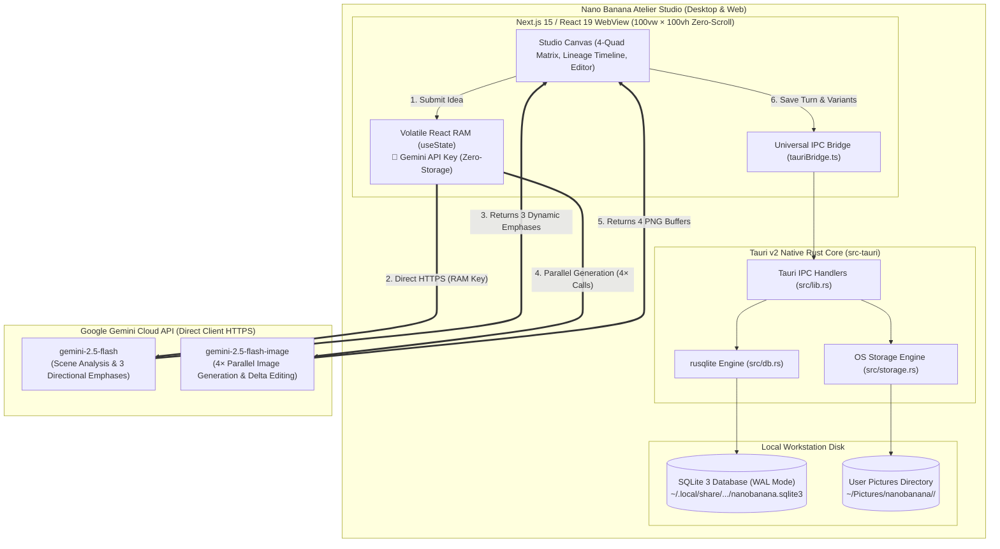

# Official Documentation — Nano Banana Atelier Studio 🍌✦

Welcome to the comprehensive technical and architectural documentation suite for **Nano Banana Atelier Studio**, an installable Desktop and Web studio for AI-assisted visual art direction and multi-turn conversational image creation powered by **Google Nano Banana (`gemini-2.5-flash-image`)**, **Tauri v2**, **Next.js 15 / React 19**, and **Local SQLite**.

---

## 🍌 Architectural Highlights

The platform is designed around four core technical pillars:

1. **Lightweight Native Desktop Application (`src-tauri/`)**:
   - Engineered with **Tauri v2** (Rust core) and **WebKitGTK / WebKit / WebView2**, outputting lightweight (~12 MB) cross-platform native packages (`.deb`, `.AppImage`, `.dmg`, `.msi`).
   - Zero Docker, Podman, PostgreSQL, or S3 container dependencies.
2. **Local-First SQLite Persistence (`nanobanana.sqlite3`)**:
   - Managed natively by `rusqlite` in `src-tauri/src/db.rs` with automatic Node.js 22 SQLite fallback in `frontend/src/app/api/db/route.ts` for browser development.
   - Operates in WAL mode with schema for `users`, `conversations`, `conversation_turns`, and `app_vault`.
3. **Native OS Filesystem Image Storage (`~/Pictures/nanobanana/`)**:
   - High-resolution `.png` frames are organized directly on disk by project name (`~/Pictures/nanobanana/<project-name>/`), remaining accessible from the file manager even if a project is removed from the app UI.
4. **4-Quad Parallel Generation & Non-Destructive Lineage**:
   - Every round prompts `gemini-2.5-flash` to formulate 3 distinct scene emphases, dispatching all 4 variations concurrently to `gemini-2.5-flash-image`.
   - Branching timeline with origin tracking (`de #X ➔`), `⚡ Surgical Delta` mode, and `🧬 Pin DNA` character facial locks.
5. **Zero-Storage Volatile RAM API Key Policy**:
   - The creator's Google Gemini API Key (`AIza...`) resides strictly in volatile React component RAM (`useState`), with an optional opt-in toggle to persist locally in the desktop's SQLite `app_vault` table.

---

## 📚 Documentation Index (`docs/`)

| Document | Description |
| :--- | :--- |
| **[1. Documentation Index (`README.md`)](./README.md)** | Executive architecture summary, core pillars, and documentation directory. |
| **[2. System Architecture (`architecture.md`)](./architecture.md)** | Component topology (Tauri v2 Rust Core, Next.js WebView, Universal IPC Bridge, SQLite, Filesystem, and Direct Browser Gemini API). |
| **[3. Data Models (`data-models.md`)](./data-models.md)** | SQLite entity-relationship schema (`users`, `conversations`, `conversation_turns`, `app_vault`) and TypeScript interfaces. |
| **[4. Processing Pipelines (`processing-pipelines.md`)](./processing-pipelines.md)** | Step-by-step sequence and flowcharts for Quad Generation (1+3), Surgical Delta, Branching Lineage, Filesystem Sync, and Modifiers AI. |
| **[5. Desktop Operations & Packaging (`desktop-operations.md`)](./desktop-operations.md)** | Native desktop compilation, packaging (`.deb`, `.AppImage`, `.dmg`, `.msi`), system headers, and GitHub Actions CI/CD release workflow. |
| **[6. SQLite & Filesystem Storage (`sqlite-and-storage.md`)](./sqlite-and-storage.md)** | Embedded database lifecycle, WAL configuration, IPC command tables, and `~/Pictures/nanobanana` directory conventions. |
| **[7. Security & API Key Policy (`security-and-auth.md`)](./security-and-auth.md)** | Volatile RAM API key isolation, Zero-Storage invariants, and optional Local App Vault persistence. |

### Root & Architectural Specifications
- **[`../README.md`](../README.md)**: Main repository quickstart and overview.
- **[`../AGENT.md`](../AGENT.md)**: Engineering guidelines, architecture rules, and conventions for AI coding agents.
- **[`../PRODUCT.md`](../PRODUCT.md)**: Product vision, user personas, and brand commitments (*Impeccable Init*).
- **[`../DESIGN.md`](../DESIGN.md)**: Neo-Brutalist design system specifications and *Impeccable Craft Floor*.

---

## 🗺️ End-to-End Architecture Flow

