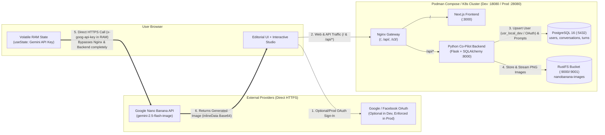

# Official Documentation — Nano Banana Studio 🍌✦

Welcome to the comprehensive technical and architectural documentation for **Nano Banana Studio**, an interactive web platform for AI-assisted art direction and multi-turn conversational image creation powered by **Google Nano Banana (`gemini-2.5-flash-image`)**.

The platform combines:
- **Next.js Frontend (Editorial Neo-Brutalist UI)** with an **Editorial Showcase Area** (4-stage interactive walkthrough + 3-turn evolution simulator) and an **Interactive Studio**.
- **Nginx Reverse Proxy Gateway (`infra/nginx/nginx.conf`)** fronting all services (`/`, `/api/`, `/s3/`, `/rustfs-console/`, `/nginx-health`) with a **Port Pad Convention (`+10000` in Dev `docker-compose.dev.yml` and `+20000` in Production `docker-compose.yml`)**.
- **Python Interactive Prompt Co-Pilot (Modular Flask + SQLAlchemy + Alembic)** for completeness diagnostics (`0–100%`), guided questions, prompt variations, and multi-turn refinement.
- **Flexible Authentication (Frictionless Local Dev + Google & Facebook OAuth)**:
  - **Local Development (`docker-compose.dev.yml`, `REQUIRE_AUTH=false`)**: No login required — automatically uses the local developer profile (`usr_local_dev`) so developers can immediately use the Studio, PostgreSQL history, and RustFS bucket on a local instance (with optional Google/Facebook sign-in available in the navbar).
  - **Production (`docker-compose.yml` & Kubernetes `infra/deployment.yaml`, `REQUIRE_AUTH=true`)**: Enforces **Google OAuth 2.0 (`POST /api/auth/google`)** or **Facebook Login (`POST /api/auth/facebook`)**, persisting users, conversations, and full prompt evolution history in **PostgreSQL 16 (`postgres`)** via **SQLAlchemy** and versioned **Alembic** migrations.
- **RustFS Object Storage Bucket (`rustfs/rustfs:latest`, S3-compatible)** storing all generated and iterated images inside the `nanobanana-images` bucket for **later consultation** (`GET /api/users/<id>/gallery`) and 1-click branching.
- **Strict Zero-Storage Gemini API Key Policy**: Calls to Google Nano Banana go directly from the user's browser using an API key held **exclusively in volatile React RAM (`useState`)**, never touching Nginx, the Python Flask backend, PostgreSQL, or RustFS.
- **Kubernetes Application Manifests (`infra/deployment.yaml` & `infra/k8s/`)**: Production Kubernetes manifests deploying only the application tier (`frontend`, `backend`, `nginx` gateway, `ingress`, `hpa`) connecting to externally provisioned PostgreSQL and RustFS/S3 Bucket infrastructure.

---

## 📚 Documentation Index (`docs/`)

| Document | Description |
| :--- | :--- |
| **[1. Overview & Index (`README.md`)](./README.md)** | Executive overview, architectural pillars, end-to-end user journey, and quickstart commands. |
| **[2. System Architecture (`architecture.md`)](./architecture.md)** | Full component topology (Nginx Gateway, Next.js, Flask + SQLAlchemy, PostgreSQL 16, RustFS S3 Bucket, Local Dev / Google / Facebook Auth, and direct Browser → Google Nano Banana flow) with Mermaid diagrams. |
| **[3. Data Models (`data-models.md`)](./data-models.md)** | Entity-Relationship diagram (`erDiagram`), PostgreSQL SQLAlchemy data dictionary (`users`, `conversations`, `conversation_turns`), RustFS S3 object key hierarchy, and TypeScript interfaces. |
| **[4. Processing Pipelines (`processing-pipelines.md`)](./processing-pipelines.md)** | Step-by-step sequence and flowchart diagrams for all 5 core processing pipelines (Prompt Diagnostics, Multi-Turn Refinement, Direct Browser Generation in RAM, Postgres+RustFS Persistence, and Nginx Gateway Routing). |
| **[5. Database & RustFS Bucket API Contracts (`database-and-bucket.md`)](./database-and-bucket.md)** | Detailed Request/Response JSON contracts for `/api/auth/google`, `/api/auth/facebook`, `/api/conversations`, `/api/conversations/<id>/turns`, `/api/users/<id>/gallery`, and `/api/bucket/<key>`. |
| **[6. Zero-Storage Security & Social Auth (`security-and-auth.md`)](./security-and-auth.md)** | Volatile RAM API key isolation (`useState`), Flask `zero_storage_api_key_guard` middleware, Local Dev mode (`REQUIRE_AUTH=false`), and Google/Facebook OAuth configuration. |
| **[7. Podman Compose & Docker Compose Operations (`podman-compose.md`)](./podman-compose.md)** | Complete guide for `docker-compose.dev.yml` (Port Pad `+10000`) and `docker-compose.yml` (Port Pad `+20000`), port table, persistent volumes, and troubleshooting. |

### Root & Infrastructure Guides
- **[`../README.md`](../README.md)**: Main repository README and quickstart.
- **[`../AGENT.md`](../AGENT.md)**: Engineering and architecture guide for AI agents and developers.
- **[`../PRODUCT.md`](../PRODUCT.md)**: Product vision, user personas, and security boundaries (*Impeccable Init*).
- **[`../DESIGN.md`](../DESIGN.md)**: Editorial Neo-Brutalist design system specification and *Impeccable Craft Floor*.
- **[`../infra/deployment.md`](../infra/deployment.md)**: Kubernetes deployment guide for `infra/deployment.yaml` and `infra/k8s/` (assuming external PostgreSQL & external RustFS/S3 Bucket).

---

## 🗺️ End-to-End Architecture Flow

