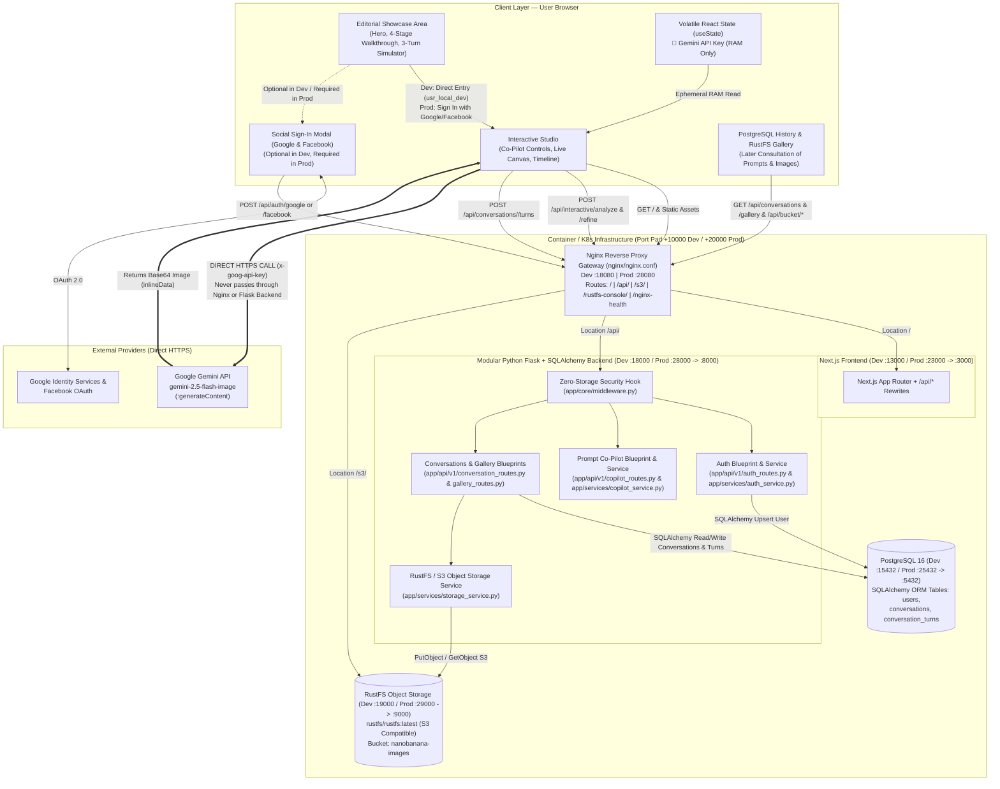

# System Architecture — Nano Banana Studio 🍌✦

This document details the distributed architecture of **Nano Banana Studio**, illustrating how the **Nginx Reverse Proxy Gateway (`nginx:1.27-alpine`)**, **Next.js Frontend**, **Python Flask + SQLAlchemy Backend**, **PostgreSQL 16 Database**, **RustFS S3-Compatible Object Storage Bucket (`rustfs/rustfs:latest`)**, **Social OAuth Providers (Google & Facebook)**, and **Google Gemini Nano Banana API** interact with strict security and low latency.

---

## 1. Component Topology & Separation of Planes

The system architecture is built on three core principles:

1. **Unified Nginx Reverse Proxy Gateway (`docker-compose.dev.yml`, `docker-compose.yml`, and `infra/deployment.yaml`)**:
   - An **Nginx (`infra/nginx/nginx.conf`)** reverse proxy receives incoming traffic on the **Port-Padded** gateway port (`:18080` in Dev `+10000`; `:28080` in Prod `+20000`) and routes requests transparently to `frontend:3000` (`/`), `backend:8000` (`/api/`), `rustfs:9000` (`/s3/`), and `rustfs:9001` (`/rustfs-console/`).
2. **Control, Co-Pilot & Persistence Plane (`Frontend <-> Nginx <-> Modular Flask Backend <-> PostgreSQL + RustFS Bucket`)**:
   - Implemented in an enterprise modular package (`backend/app/{core,db,models,services,api/v1}` + `backend/wsgi.py`). Manages user identity (frictionless auto-provisioned `usr_local_dev` in Dev mode when `REQUIRE_AUTH=false`, and enforced **Google OAuth 2.0** or **Facebook Login** in Production mode when `REQUIRE_AUTH=true`), heuristic prompt engineering, multi-turn conversation history (`conversations`, `conversation_turns`), and S3 image storage in **RustFS** (`nanobanana-images`) for later consultation. **No Gemini API key ever transits through this plane.**
3. **Zero-Storage Generative Execution Plane (`Browser RAM -> Google Gemini API`)**:
   - Connects the user's browser **directly** to `https://generativelanguage.googleapis.com` using the API key held exclusively in volatile React memory (`useState`), bypassing Nginx and the Python Flask backend completely.

---

## 2. Port Pad Convention (`+10000` Dev vs. `+20000` Prod)

| Service | Internal Port | **Dev Environment (`docker-compose.dev.yml`)** Port Pad **`+10000` (`1xxxx`)** | **Prod Environment (`docker-compose.yml`)** Port Pad **`+20000` (`2xxxx`)** |
| :--- | :---: | :---: | :---: |
| **`nginx`** *(Unified Gateway)* | `80` | `http://localhost:18080` | `http://localhost:28080` |
| **`frontend`** *(Next.js)* | `3000` | `http://localhost:13000` | `http://localhost:23000` |
| **`backend`** *(Flask `wsgi:app`)* | `8000` | `http://localhost:18000` | `http://localhost:28000` |
| **`postgres`** *(PostgreSQL 16)* | `5432` | `localhost:15432` | `localhost:25432` |
| **`rustfs`** *(S3 API)* | `9000` | `http://localhost:19000` | `http://localhost:29000` |
| **`rustfs`** *(Web Console)* | `9001` | `http://localhost:19001` | `http://localhost:29001` |

---

## 3. Authentication Modes: Local Dev Instance vs. Production OAuth (Google & Facebook)

### 3.1 Local / Development Mode (`docker-compose.dev.yml`, `REQUIRE_AUTH=false`)
In `docker-compose.dev.yml`, `REQUIRE_AUTH` and `NEXT_PUBLIC_REQUIRE_AUTH` default to `false` so developers running a local instance can jump straight into the Interactive Studio without any login barrier:
- Clicking **"INICIAR CRIAÇÃO ★"** or **"Abrir Studio"** enters the Studio immediately as `usr_local_dev` (`Local Dev Instance`, `dev@localhost`).
- The Flask + SQLAlchemy backend automatically ensures the `usr_local_dev` record exists in PostgreSQL (`users`), so conversation saving and RustFS bucket gallery consultation work out-of-the-box.
- Developers can still click the navbar sign-in button at any time to test **Google** or **Facebook** authentication.

### 3.2 Production Mode (`docker-compose.yml` & Kubernetes `infra/deployment.yaml`, `REQUIRE_AUTH=true`)
In `docker-compose.yml` and Kubernetes (`infra/deployment.yaml` / `infra/k8s/`), `REQUIRE_AUTH` and `NEXT_PUBLIC_REQUIRE_AUTH` are set to `true`:
- Entering the Studio requires authenticating via **Google (`POST /api/auth/google`)** or **Facebook (`POST /api/auth/facebook`)**.
- The Flask backend verifies the token and upserts the `User` in PostgreSQL via SQLAlchemy.
