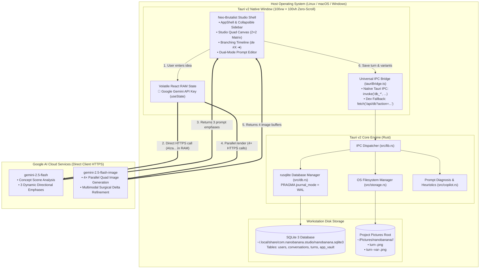

# System Architecture — Nano Banana Atelier Studio 🍌✦

This document details the software architecture of **Nano Banana Atelier Studio**, illustrating the interactions between the **Next.js 15 / React 19 Frontend WebView**, the **Tauri v2 Native Rust Core**, the **Local SQLite Database (`nanobanana.sqlite3`)**, the **Native OS Filesystem (`~/Pictures/nanobanana/`)**, and **Google Cloud Gemini APIs (`gemini-2.5-flash` and `gemini-2.5-flash-image`)**.

---

## 1. System Topology & Separation of Tiers

Nano Banana Studio is built on three architectural tiers:

1. **Presentation & Creative UI Tier (`frontend/`)**:
   - Engineered in **Next.js 15** with **React 19** and TypeScript.
   - Operates inside an OS-native desktop WebView (or local browser during standalone development).
   - Manages prompt composition, the `2×2` Quad Generation Matrix, side-by-side Lightbox comparisons, the interactive branching timeline, and modifier categories.
   - Enforces the **Zero-Storage Volatile RAM Policy**: the Gemini API key lives in `useState` and never leaves volatile client memory without explicit user consent.
2. **Native Orchestration Tier (`src-tauri/`)**:
   - Engineered in **Rust** using **Tauri v2**.
   - Handles IPC commands dispatched by the frontend bridge (`frontend/src/core/tauri/tauriBridge.ts`).
   - Manages relational SQLite persistence via `rusqlite` ([`src-tauri/src/db.rs`](file:///usr/local/google/home/vieiravitor/workspace/opensource/nanobanana-inspiration/src-tauri/src/db.rs)).
   - Manages filesystem operations, project directory synchronization, and image writing ([`src-tauri/src/storage.rs`](file:///usr/local/google/home/vieiravitor/workspace/opensource/nanobanana-inspiration/src-tauri/src/storage.rs)).
   - Executes native prompt diagnosis and refinement heuristics ([`src-tauri/src/copilot.rs`](file:///usr/local/google/home/vieiravitor/workspace/opensource/nanobanana-inspiration/src-tauri/src/copilot.rs)).
3. **Generative Execution Plane (Direct Client HTTPS)**:
   - Connects the user's browser/WebView **directly** to `https://generativelanguage.googleapis.com` via standard HTTPS fetch calls ([`nanobananaClient.ts`](file:///usr/local/google/home/vieiravitor/workspace/opensource/nanobanana-inspiration/frontend/src/features/studio/services/nanobananaClient.ts)).
   - Uses `cache: "no-store"` to ensure generated image buffers and API tokens are never cached in browser disk caches.

---

## 2. Component Architecture Diagram



---

## 3. Universal Bridge & Development Abstraction

To ensure fluid development velocity without requiring full Rust compilation during every CSS or React component change, the platform implements a **Universal Bridge** ([`frontend/src/core/tauri/tauriBridge.ts`](file:///usr/local/google/home/vieiravitor/workspace/opensource/nanobanana-inspiration/frontend/src/core/tauri/tauriBridge.ts)):

```mermaid
flowchart LR
    Caller["Frontend Service / Component"] --> Bridge["tauriBridge.ts"]

    Bridge --> Check{"window.__TAURI_INTERNALS__\npresent?"}
    
    Check -->|YES (Desktop App)| Native["Tauri Core IPC\n@tauri-apps/api/core.invoke()"]
    Check -->|NO (Web Dev)| DevRoute["Node.js 22 SQLite Route\nfetch('/api/db?action=...')"]

    Native --> Rusqlite["rusqlite (Rust)"]
    DevRoute --> NodeSqlite["node:sqlite (Next.js Node)"]
```

Both paths enforce identical relational schemas, foreign key cascades, and directory creation semantics.

---

## 4. State & Data Flow Invariants

1. **Zero Base64 in Database**: SQLite stores exclusively metadata, prompt texts, and file paths (`image_path`). Raw image binary data is written directly to disk (`~/Pictures/nanobanana/`), keeping database size minimal and queries instantaneous.
2. **Non-Destructive Lineage**: Every turn stores `parent_turn_number`. Returning to an earlier turn does not mutate prior records; it seeds the editor for a new child branch.
3. **Filesystem Synchronization**: Renaming a project in the application UI invokes `db_rename_project`, which updates both SQLite and renames the physical directory on disk (`~/Pictures/nanobanana/<new-name>/`), updating all stored image paths atomically.
