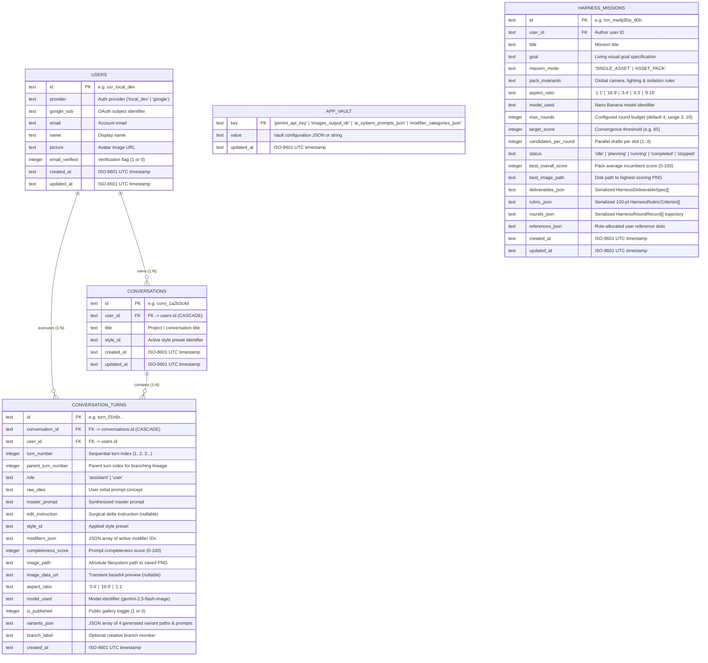

# Data Models & Schemas — Nano Banana Atelier Studio 🍌✦

This document specifies the relational data models, SQLite table schemas, and TypeScript interfaces used across **Nano Banana Atelier Studio**.

---

## 1. Relational Entity-Relationship Diagram (`erDiagram`)



---

## 2. Table Specifications (`nanobanana.sqlite3`)

### 2.1 Table: `users`
Identifies the active user or local developer profile:

| Column | Type | Constraints | Description |
| :--- | :--- | :--- | :--- |
| `id` | `TEXT` | `PRIMARY KEY` | Identifier (e.g. `usr_local_dev`). |
| `provider` | `TEXT` | `NOT NULL DEFAULT 'local_dev'` | Authentication type (`'local_dev'` or `'google'`). |
| `google_sub` | `TEXT` | `NOT NULL` | External provider subject or placeholder. |
| `email` | `TEXT` | `NOT NULL` | Creator email address. |
| `name` | `TEXT` | `NOT NULL` | Display name shown in UI header. |
| `picture` | `TEXT` | `NOT NULL DEFAULT ''` | Avatar URL or inline SVG identifier. |
| `email_verified` | `INTEGER` | `NOT NULL DEFAULT 1` | Verification flag (`1` for true). |
| `created_at` | `TEXT` | `NOT NULL` | ISO-8601 timestamp. |
| `updated_at` | `TEXT` | `NOT NULL` | ISO-8601 timestamp. |

### 2.2 Table: `conversations`
Top-level project container grouping visual iteration turns:

| Column | Type | Constraints | Description |
| :--- | :--- | :--- | :--- |
| `id` | `TEXT` | `PRIMARY KEY` | Unique ID (e.g. `conv_9f8e7d6c`). |
| `user_id` | `TEXT` | `NOT NULL, FK -> users(id)` | Project creator ID. |
| `title` | `TEXT` | `NOT NULL` | Project name (syncs with directory on disk). |
| `style_id` | `TEXT` | `NOT NULL DEFAULT 'editorial-anime'` | Default style preset ID. |
| `created_at` | `TEXT` | `NOT NULL` | Creation timestamp. |
| `updated_at` | `TEXT` | `NOT NULL` | Timestamp of latest activity. |

### 2.3 Table: `conversation_turns`
Stores prompt parameters, generation outputs, and branching links:

| Column | Type | Constraints | Description |
| :--- | :--- | :--- | :--- |
| `id` | `TEXT` | `PRIMARY KEY` | Turn identifier (e.g. `turn_abc123`). |
| `conversation_id` | `TEXT` | `NOT NULL, FK -> conversations(id)` | Parent project container. |
| `user_id` | `TEXT` | `NOT NULL` | Author user ID. |
| `turn_number` | `INTEGER` | `NOT NULL DEFAULT 1` | Turn sequence index within project. |
| `parent_turn_number` | `INTEGER` | `NULLABLE` | Previous turn index if branched. |
| `role` | `TEXT` | `NOT NULL DEFAULT 'assistant'` | Turn agent role. |
| `raw_idea` | `TEXT` | `NOT NULL DEFAULT ''` | Original natural language input. |
| `master_prompt` | `TEXT` | `NOT NULL DEFAULT ''` | Synthesized prompt sent to image generator. |
| `edit_instruction` | `TEXT` | `NULLABLE` | Surgical delta directive (if applicable). |
| `style_id` | `TEXT` | `NOT NULL DEFAULT 'editorial-anime'` | Applied style preset. |
| `modifiers_json` | `TEXT` | `NOT NULL DEFAULT '[]'` | JSON array of active modifier slugs. |
| `completeness_score` | `INTEGER` | `NOT NULL DEFAULT 80` | Prompt completeness score (`0–100`). |
| `image_path` | `TEXT` | `NULLABLE` | Absolute path to primary saved PNG. |
| `image_data_url` | `TEXT` | `NULLABLE` | Ephemeral preview data URL. |
| `aspect_ratio` | `TEXT` | `NOT NULL DEFAULT '3:4'` | Canvas aspect ratio (`'3:4'`, `'16:9'`, `'1:1'`). |
| `model_used` | `TEXT` | `NOT NULL DEFAULT 'gemini-2.5-flash-image'` | Generation model name. |
| `is_published` | `INTEGER` | `NOT NULL DEFAULT 0` | Published to showcase gallery (`1`/`0`). |
| `variants_json` | `TEXT` | `NULLABLE` | Serialized JSON array of 4 quad outputs. |
| `branch_label` | `TEXT` | `NULLABLE` | Optional branch name (e.g. `Branch from #2`). |
| `created_at` | `TEXT` | `NOT NULL` | Creation timestamp. |

### 2.4 Table: `app_vault`
Key-value configuration store for local desktop preferences:

| Key | Type | Description |
| :--- | :--- | :--- |
| `gemini_api_key` | `TEXT` | User-consented local storage of Google AI Studio API key (`AIza...`). |
| `images_output_dir` | `TEXT` | Custom filesystem path for generated images root (default: `~/Pictures/nanobanana`). |

---

## 3. TypeScript Interfaces

```typescript
// frontend/src/features/history/types/history.types.ts

export interface VariantRecord {
  index: number;
  label: string;
  emphasis: string;
  prompt: string;
  image_path?: string;
  image_data_url?: string;
}

export interface ConversationTurn {
  id: string;
  conversation_id: string;
  user_id: string;
  turn_number: number;
  parent_turn_number?: number | null;
  role: "assistant" | "user";
  raw_idea: string;
  master_prompt: string;
  edit_instruction?: string | null;
  style_id: string;
  modifiers: string[];
  completeness_score: number;
  image_path?: string | null;
  image_data_url?: string | null;
  aspect_ratio: "3:4" | "16:9" | "1:1";
  model_used: string;
  is_published: boolean;
  variants?: VariantRecord[];
  branch_label?: string | null;
  created_at: string;
}

export interface ConversationDetail {
  id: string;
  user_id: string;
  title: string;
  style_id: string;
  turn_count: number;
  latest_prompt?: string | null;
  preview_image_url?: string | null;
  created_at: string;
  updated_at: string;
  turns: ConversationTurn[];
}
```
