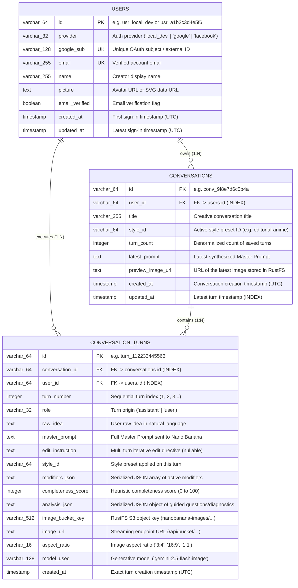

# Data Models & Schemas — Nano Banana Studio 🍌✦

This document specifies the end-to-end **Data Models** of **Nano Banana Studio**, covering:
1. **PostgreSQL 16 Relational Schema (`backend/app/models/user.py` & `backend/app/models/conversation.py` via SQLAlchemy 2.0 ORM & Alembic Migrations `backend/migrations/`)**: Tables `users`, `conversations`, and `conversation_turns`.
2. **RustFS S3 Object Storage Hierarchy (`backend/app/services/storage_service.py`)**: Object key layout inside the `nanobanana-images` bucket.
3. **Flask Backend Request/Response Payloads (`backend/app/api/v1/` & `backend/app/services/`)**.
4. **Frontend TypeScript Interfaces (`frontend/src/features/{auth,studio,history}/types/`)**.

> **Zero-Storage Data Invariant**: No SQLAlchemy model, JSON payload, TypeScript persistence interface, or S3 object metadata contains any field for storing a Google Gemini API key (`AIza...`). The API key exists strictly in volatile React RAM (`useState`) during the active browser tab session.

---

## 1. Entity-Relationship Diagram (`erDiagram`) — PostgreSQL (SQLAlchemy)



---

## 2. Relational Data Dictionary (SQLAlchemy Models)

### 2.1 `User` (`users` table)
Stores the creator profile — either auto-provisioned in Local Dev Mode (`id="usr_local_dev"`, `provider="local_dev"`) or authenticated via Google (`POST /api/auth/google`, `provider="google"`) or Facebook (`POST /api/auth/facebook`, `provider="facebook"`).

| Column | SQL Type | Constraints | Description |
| :--- | :--- | :--- | :--- |
| `id` | `VARCHAR(64)` | `PRIMARY KEY` | Internal user ID (`usr_local_dev` or `usr_<hash>`). |
| `provider` | `VARCHAR(32)` | `DEFAULT 'google'` | Identity provider (`'local_dev'`, `'google'`, or `'facebook'`). |
| `google_sub` | `VARCHAR(128)` | `UNIQUE, INDEX` | Unique provider subject identifier. |
| `email` | `VARCHAR(255)` | `UNIQUE, NOT NULL, INDEX` | User email address. |
| `name` | `VARCHAR(255)` | `NOT NULL` | Display name of the creator. |
| `picture` | `TEXT` | `NULLABLE` | Profile avatar URL or generated initials SVG data URL. |
| `email_verified` | `BOOLEAN` | `DEFAULT TRUE` | Email verification status. |
| `created_at` | `TIMESTAMP` | `NOT NULL` | First creation timestamp. |
| `updated_at` | `TIMESTAMP` | `NOT NULL` | Updated on each sign-in. |

### 2.2 `Conversation` (`conversations` table)
Represents a multi-turn creative session linked to `users.id`.

### 2.3 `ConversationTurn` (`conversation_turns` table)
Stores every single iteration (initial generation or conversational multi-turn edit) inside a conversation, including `master_prompt`, `edit_instruction`, `completeness_score`, and the RustFS S3 object reference (`image_bucket_key` and `image_url`).

---

## 3. Object Storage Model — RustFS S3 Bucket (`nanobanana-images`)

```text
Bucket: nanobanana-images
│
└── {user_id}/                                  # e.g. usr_local_dev or usr_a1b2c3d4e5f6
    └── {conversation_id}/                      # e.g. conv_9f8e7d6c5b4a
        ├── turn-1-8f12a9c0.png                 # Frame generated on Turn #1
        ├── turn-2-3d44b1e2.png                 # Multi-turn edit #2
        └── turn-3-9c01e7f4.png                 # Multi-turn edit #3
```

---

## 4. Frontend TypeScript Interfaces (`frontend/src/features/*/types/`)

- `frontend/src/features/auth/types/auth.types.ts`: `GoogleUserProfile`, `AuthProvider` (`"google" | "facebook" | "local_dev"`).
- `frontend/src/features/studio/types/studio.types.ts`: `NanoBananaModel`, `GenerateNanoBananaRequest`, `GenerateNanoBananaResult`.
- `frontend/src/features/history/types/history.types.ts`: `SavedConversationSummary`, `SavedConversationTurn`, `GalleryItem`.

```ts
export type AuthProvider = "google" | "facebook" | "local_dev";

export interface GoogleUserProfile {
  id: string;
  name: string;
  email: string;
  picture: string;
  provider: AuthProvider;
  authenticatedAt: string;
}

export interface GenerateNanoBananaRequest {
  apiKey: string; // Read exclusively from React useState in RAM — NEVER persisted
  model: "gemini-2.5-flash-image" | "gemini-2.0-flash-exp-image-generation";
  prompt: string;
  referenceImage?: { mimeType: string; data: string } | null;
}
```

---

## 5. Database Schema Evolution & Alembic Migrations (`backend/migrations/`)

Schema changes are versioned and applied using **Alembic** (`backend/alembic.ini` and `backend/migrations/`):

- **Configuration**: `backend/alembic.ini` and `backend/migrations/env.py` dynamically resolve `DATABASE_URL` from `app.core.config` and bind `target_metadata = Base.metadata` from `app.db.session` and `app.models`.
- **Initial Revision**: `backend/migrations/versions/20261102_0001_initial_schema.py` creates `users`, `conversations`, and `conversation_turns` along with their foreign keys and indexes (`ix_users_email`, `ix_users_google_sub`, `ix_conversations_user_id`, `ix_conversations_updated_at`, `ix_conversation_turns_conversation_id`, `ix_conversation_turns_user_id`).
- **Operational Commands**:
  ```bash
  # Apply all pending migrations up to head
  cd backend && .venv/bin/alembic upgrade head

  # Or via the Flask CLI command registered on the app factory
  cd backend && .venv/bin/flask --app wsgi:app db-upgrade

  # Generate a new migration revision from SQLAlchemy model changes
  cd backend && .venv/bin/alembic revision --autogenerate -m "add_new_column"

  # Roll back the last migration
  cd backend && .venv/bin/alembic downgrade -1
  ```
- **Automated Container & Kubernetes Startup**: Both `backend/Dockerfile` (`docker-compose.yml` / `docker-compose.dev.yml`) and Kubernetes (`infra/deployment.yaml` / `infra/k8s/backend-deployment.yaml`) execute `alembic upgrade head` automatically before starting the Flask/Gunicorn server.
