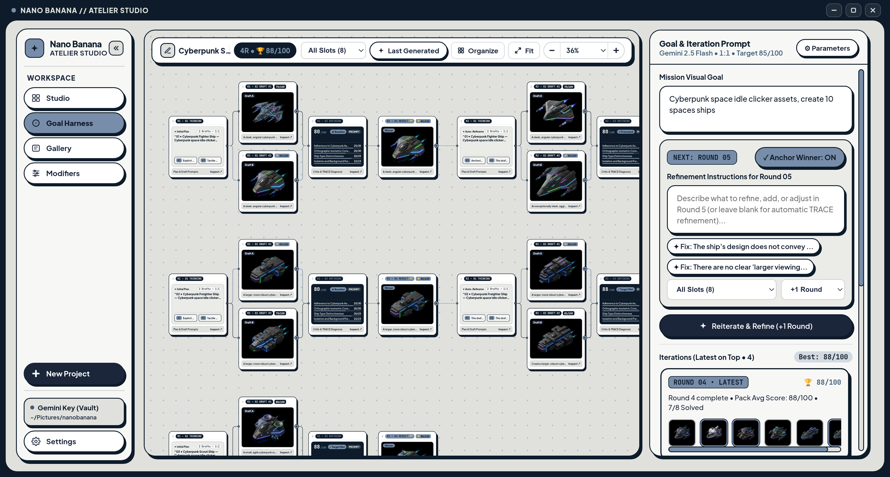
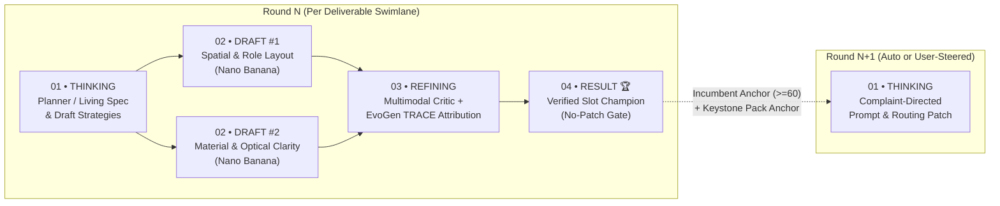
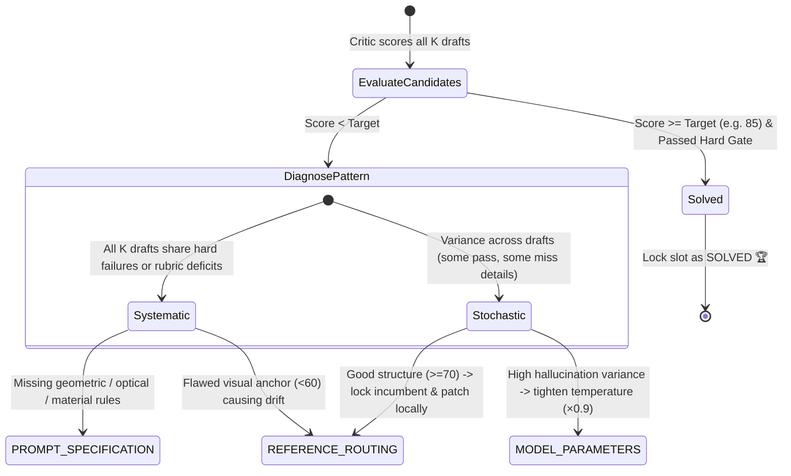

# Goal-Driven Agent Harness & Thinking Process (`AutoRef + EvoGen TRACE`) 🍌✦

This document details the architecture, multi-agent reasoning loop, scoring mathematics, and self-correction mechanisms of the **Nano Banana Goal Harness** (`/harness` — implemented in [`harnessAgentService.ts`](../frontend/src/features/harness/services/harnessAgentService.ts) and [`harness/page.tsx`](../frontend/src/app/harness/page.tsx)).

---

## 1. Why Wrap Nano Banana in a Closed-Loop Harness?

Modern multimodal image generators like **Google Nano Banana (`gemini-2.5-flash-image` and `gemini-3-pro-image-preview`)** can render extraordinary imagery, yet single-shot prompting breaks down on production creative tasks:

1. **Multi-Asset Pack Drift**: Asking for *"8 cyberpunk idle-clicker spaceships in 30° isometric projection"* in separate single-shot prompts produces inconsistent camera angles, mismatched lighting directions, and incompatible material shaders across slots.
2. **Silent Hard Failures**: A single generation may clip a wing silhouette, drift from orthographic isometric into perspective view, or introduce background clutter without the generator noticing.
3. **Blind Iterative Anchoring**: Feeding a flawed Round 1 image (`score < 60`) back into Round 2 as a multimodal reference locks the generator into a broken composition, whereas discarding a strong Round 1 image (`score >= 60`) loses hard-won structural identity.
4. **Prompt & Specification Drift Across User Edits**: When a user steers Round 3 with *"add a lightning storm"* after Round 1 asked for *"calm sunny sunset"*, naive prompt appending creates contradictory instructions that confuse both the generator and evaluator.

The **Goal Harness** solves all four problems by wrapping Nano Banana inside a **4-Stage Closed-Loop Multi-Agent System** combining principles from **AutoRef-Harness** (*Explicit Reference Role Allocation, Hard-Failure Gate, Pairwise Judge, Complaint-Directed Revision*) and **EvoGen-Harness** (*TRACE — Trajectory-Relative Attribution and Coordinated Evolution + No-Patch Regression Gate*).

---

## 2. End-to-End 4-Stage Pipeline Architecture

Every round on the Infinite Flow Canvas executes strictly from **Left to Right** across four visual node columns per deliverable swimlane, with inter-round trajectory wires connecting Round $N$'s Champion (`04 RESULT 🏆`) to Round $N+1$'s Strategy (`01 THINKING`):

---

## 3. Deep Dive Into Each Stage & Agent Thinking

### Stage 01 — `THINKING & PLAN` (`runHarnessPlannerAgent`)

When a user enters a high-level goal (e.g., *"Cyberpunk space idle clicker assets, create 10 spaceships"*), the **Planner Agent** (`gemini-2.5-flash` in structured JSON mode) decomposes the request before a single pixel is rendered:

1. **Single Scene vs. Multi-Asset Pack Classification**:
   - Single editorial scene $\rightarrow$ `1` deliverable (`SINGLE_ASSET`).
   - Game asset pack / sprite collection $\rightarrow$ up to `8` distinct, non-overlapping deliverable slots (`ASSET_PACK`, e.g., `01 • Cyberpunk Fighter Ship` through `08 • Cyberpunk Repair Drone/Ship`), each rendered in its own horizontal swimlane on the Flow Canvas.
2. **Global Pack Invariants (`globalPackInvariants`)**:
   - Extracts strict cross-pack visual laws that every deliverable must obey simultaneously (e.g., *"True 30-degree orthographic isometric 2:1 projection, centered uncut silhouette, isolated dark-slate background, top-left warm key light with cyan neon rim accents"*).
3. **Explicit Reference Role Allocation (*AutoRef-Harness*)**:
   - Up to 2 user-supplied reference images are assigned explicit, non-conflicting roles (`Slot #1: Identity & Subject Anchor`, `Slot #2: Isometric Style & Palette Anchor`) so the image generator knows *what* to borrow from each reference.
4. **100-Point Weighted Evaluation Rubric**:
   - Synthesizes 4 domain-specific criteria whose integer weights sum to exactly `100` (e.g., *Deliverable & Theme Fidelity: 30*, *Isometric Projection & Pack Cohesion: 30*, *Materiality & Lighting: 20*, *Clean Isolation & Readability: 20*).

---

### Stage 02 — `CANDIDATE DRAFTS` & Conditional Reference Routing

For each unsolved deliverable slot, the harness dispatches $K$ parallel candidate prompts (`candidatesPerSlot`, default `2`, up to `4`) to Nano Banana (`gemini-2.5-flash-image` or `gemini-3-pro-image-preview`):

- **Round 1 Strategy Diversification**:
  - `Draft A`: *Explicit Spatial Geometry & Reference Role Allocation*
  - `Draft B`: *Tactile Materiality, Lighting & Silhouette Readability*
  - `Draft C`: *Strict Projection & Clean Background Isolation*
  - `Draft D`: *Hero Asset Polish & Chromatic Counterpoint*
- **Conditional Multimodal Reference Routing**:
  - **Primary Reference (`Incumbent Anchor >= 60` Rule)**: In Round $N > 1$, the slot's current Incumbent image is attached as `Reference #1` **only if** its verified Critic score is $\ge 60/100$ (and TRACE's `useWinnerAsReference` is `true`). If a Round 1 image scored $< 60$, it is intentionally **discarded** as a visual reference so Round 2 can rebuild the geometry from scratch instead of inheriting a broken silhouette.
  - **Secondary Reference (`Keystone Pack Anchor`)**: In multi-deliverable packs (`deliverables.length > 1`), once any deliverable achieves a high-scoring verified image, the highest-scoring deliverable in the pack becomes the **Keystone Pack Anchor** and is passed as `Reference #2` to sibling slots with instructions to match its exact camera angle, scale, and material shader finish without copying its subject geometry.

---

### Stage 03 — `MULTIMODAL CRITIC & TRACE REFINING`

Every rendered candidate image is downscaled in-memory to a crisp `384px` inspection frame for low-latency multimodal evaluation and passed to `runHarnessCriticAgent` (`gemini-2.5-flash` vision):

#### 3.1 Two-Phase Multimodal Critic
1. **Phase A — Hard-Failure Gate**:
   - Checks for catastrophic structural violations: missing subject, non-isometric camera when isometric is required, cut-off silhouette edges, unnatural copy-paste seams, or duplicated subjects.
   - Any candidate failing the Hard-Failure Gate has `passedHardGate = false` and its total score hard-capped at **`55 / 100`** (below the `60` anchor threshold and below any target convergence score).
2. **Phase B — Weighted Rubric Scoring & Actionable Complaints**:
   - Scores each of the 4 rubric criteria strictly within `[0, weight]`, lists verified `strengths` to preserve, and emits concrete, surgical `complaints` for the Refiner Agent to fix.

#### 3.2 EvoGen `TRACE` (*Trajectory-Relative Attribution & Coordinated Evolution*)
Next, `runHarnessTraceRefinerAgent` aggregates evidence across all candidates in the round to diagnose *why* flaws occurred and coordinate the next round's evolution:

| TRACE Module | Trigger Condition | Coordinated Action for Round $N+1$ |
| :--- | :--- | :--- |
| **`PROMPT_SPECIFICATION`** | Systematic failure across all candidates on shared rubric criteria | Rewrites candidate prompts via Complaint-Directed Revision to inject explicit geometric, framing, and lighting constraints. |
| **`REFERENCE_ROUTING`** | Candidate score $\ge 60$ (lock structure) **or** $< 60$ (corrupted composition) | Routes verified Incumbent ($\ge 60$) + Keystone Pack Anchor into multimodal `inlineData`, or drops flawed reference ($< 60$) to regenerate cleanly. |
| **`MODEL_PARAMETERS`** | Stochastic variance / hallucinated artifacts across parallel drafts | Scales generation `temperature` ($\times 0.9$, clamped to `[0.65, 1.20]`) and `topP` per slot. |

---

### Stage 04 — `ROUND RESULT 🏆`, No-Patch Gate & Living Specification

1. **Pairwise Judge & EvoGen No-Patch Regression Gate**:
   - Compares the round's best Challenger against the slot's existing Incumbent:
     - `INITIAL_INCUMBENT`: Round 1 baseline established.
     - `CHALLENGER_WON`: Challenger passed the Hard-Failure Gate and outperformed (or matched) the prior Incumbent, or applied an explicit user steering directive.
     - `INCUMBENT_RETAINED` (`noPatchTriggered = true`): If Round $N$'s candidates regressed below Round $N-1$'s verified Incumbent during autonomous optimization, the **No-Patch Gate** rejects the regression and retains the superior prior Incumbent so quality is monotonically non-decreasing.
2. **Living Mission Specification (`evolveMissionSpecWithUserRefinement`)**:
   - When the user types a manual refinement instruction in the right-hand **Reiteration Console** (or branches from any specific Draft/Result card's `+` port), the Specification Evolution Agent updates `goal`, `globalPackInvariants`, and targeted `deliverables[i].description` **in place**.
   - Contradictory old attributes (e.g., *"sunny calm beach"* $\rightarrow$ *"storm with lightning"*) are cleanly replaced in the living specification while compatible prior refinements (`priorDirectivesHistory` & `priorRoundTrajectory`) are preserved—preventing amnesia across 5–12+ rounds.
   - Incumbent PNGs on disk are versioned by round (`slot_<k>_r<N>_incumbent_<missionId>.png`) so historical round cards on the Flow Canvas never overwrite one another.
3. **Configurable Step Budget & Automatic Stuck-Mission Recovery**:
   - Default autonomous round count is configurable in **Settings** (`3` to `10` steps, default **`4`**).
   - On entering `/harness`, `handleLoadMission` inspects the mission record in SQLite: if a mission was interrupted after planning (`0` rounds), mid-round, or had unrendered placeholder frames, the harness automatically resumes execution from the exact unfinished round and slot.
