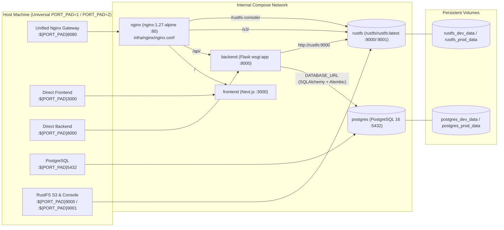

# Podman Compose & Docker Compose Operations Guide (Universal `PORT_PAD`) — Nano Banana Studio 🍌✦

This guide documents how to build, start, monitor, and troubleshoot the containerized environments of **Nano Banana Studio** using **`podman-compose`** or **`docker-compose`** with the root compose files:
- **`podman-compose.dev.yml` & `docker-compose.dev.yml` (Development — `REQUIRE_AUTH=false`)**: Runs `alembic upgrade head && flask --app wsgi:app run --reload` and `npm run dev` with live source bind mounts and frictionless auto-provisioned local developer access (`usr_local_dev`).
- **`podman-compose.yml` & `docker-compose.yml` (Production Build — `REQUIRE_AUTH=true`)**: Runs multi-stage production builds (`alembic upgrade head && gunicorn --bind 0.0.0.0:8000 --workers 2 wsgi:app` and `npm run build && npm run start`) with `restart: unless-stopped` and enforced Google/Facebook OAuth.

---

## 1. Universal `PORT_PAD` Prefix Convention

All 4 compose files (`podman-compose.yml`, `podman-compose.dev.yml`, `docker-compose.yml`, `docker-compose.dev.yml`) use a single universal **`${PORT_PAD}`** variable prefix directly in every host port mapping (`"${PORT_PAD}8080:80"`, `"${PORT_PAD}3000:3000"`, `"${PORT_PAD}8000:8000"`, `"${PORT_PAD}5432:5432"`, `"${PORT_PAD}9000:9000"`, `"${PORT_PAD}9001:9001"`).

This lets you spin up any stack on any port prefix simply by passing `PORT_PAD=<digit>`:
- **`PORT_PAD=1`**: Binds host ports `18080`, `13000`, `18000`, `15432`, `19000`, `19001`
- **`PORT_PAD=2`**: Binds host ports `28080`, `23000`, `28000`, `25432`, `29000`, `29001`
- **`PORT_PAD=3`**: Binds host ports `38080`, `33000`, `38000`, `35432`, `39000`, `39001`

| Service | Internal Container Port | Compose Port Mapping | **`PORT_PAD=1`** | **`PORT_PAD=2`** | Role |
| :--- | :---: | :---: | :---: | :---: | :--- |
| **`nginx`** *(Gateway)* | `80` | `"${PORT_PAD}8080:80"` | **`18080`** (`http://localhost:18080`) | **`28080`** (`http://localhost:28080`) | Reverse proxy fronting `/`, `/api/`, `/s3/`, `/rustfs-console/`. |
| **`frontend`** *(Next.js)* | `3000` | `"${PORT_PAD}3000:3000"` | **`13000`** (`http://localhost:13000`) | **`23000`** (`http://localhost:23000`) | Next.js web UI (Showcase + Interactive Studio). |
| **`backend`** *(Flask `wsgi:app`)* | `8000` | `"${PORT_PAD}8000:8000"` | **`18000`** (`http://localhost:18000`) | **`28000`** (`http://localhost:28000`) | Modular Python Flask + SQLAlchemy + Alembic API. |
| **`postgres`** *(PostgreSQL 16)* | `5432` | `"${PORT_PAD}5432:5432"` | **`15432`** (`localhost:15432`) | **`25432`** (`localhost:25432`) | Relational database (`users`, `conversations`, `conversation_turns`). |
| **`rustfs`** *(S3 API)* | `9000` | `"${PORT_PAD}9000:9000"` | **`19000`** (`http://localhost:19000`) | **`29000`** (`http://localhost:29000`) | RustFS S3-compatible object storage (`nanobanana-images`). |
| **`rustfs`** *(Web Console)* | `9001` | `"${PORT_PAD}9001:9001"` | **`19001`** (`http://localhost:19001`) | **`29001`** (`http://localhost:29001`) | RustFS administrative web UI (`rustfsadmin` / `rustfsadmin`). |

---

## 2. Container Topology Diagram



---

## 3. Running with `podman-compose`

### 3.1 Development Stack (`podman-compose.dev.yml`)
```bash
PORT_PAD=1 podman-compose -f podman-compose.dev.yml up -d --build
```
- **Nginx Gateway**: **`http://localhost:18080`**
- **Frontend Direct**: **`http://localhost:13000`**
- **Backend Direct**: **`http://localhost:18000/api/health`**
- **RustFS Console**: **`http://localhost:19001`** (`rustfsadmin` / `rustfsadmin`)
- **PostgreSQL 16**: **`localhost:15432`** (`nanobanana` / `nanobanana`)

### 3.2 Production Stack (`podman-compose.yml`)
```bash
# Run on pad 1 (:18080):
PORT_PAD=1 podman-compose -f podman-compose.yml up -d --build

# Or run on pad 2 (:28080):
PORT_PAD=2 podman-compose -f podman-compose.yml up -d --build
```

### 3.3 Stop Containers
```bash
podman-compose -f podman-compose.dev.yml down
podman-compose -f podman-compose.yml down
```

---

## 4. Running with `docker-compose`

```bash
# Development Stack:
PORT_PAD=1 docker-compose -f docker-compose.dev.yml up -d --build

# Production Stack:
PORT_PAD=1 docker-compose -f docker-compose.yml up -d --build
```

---

## 5. Health Verification & Kubernetes Deployment

### 5.1 Verify Gateway & Flask Backend Health (`PORT_PAD=1`)
```bash
curl -s http://localhost:18080/nginx-health
curl -s http://localhost:18080/api/health | python3 -m json.tool
```

### 5.2 Kubernetes Cluster Deployment (`infra/deployment.yaml` & `infra/k8s/`)
For deploying the stateless application tier (`frontend`, `backend` with `nanobanana-db-migrate` initContainer running `alembic upgrade head`, `nginx`, `ingress`, `hpa`) to a Kubernetes cluster where PostgreSQL and the RustFS/S3 Bucket are provisioned externally, see **[`../infra/deployment.md`](../infra/deployment.md)**:
```bash
kubectl apply -f infra/deployment.yaml
# Or with Kustomize:
kubectl apply -k infra/k8s/
```
