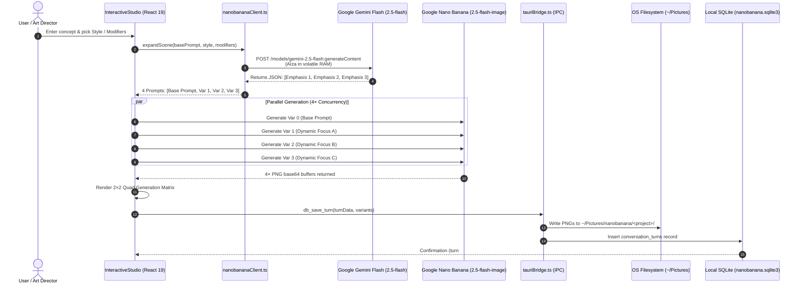
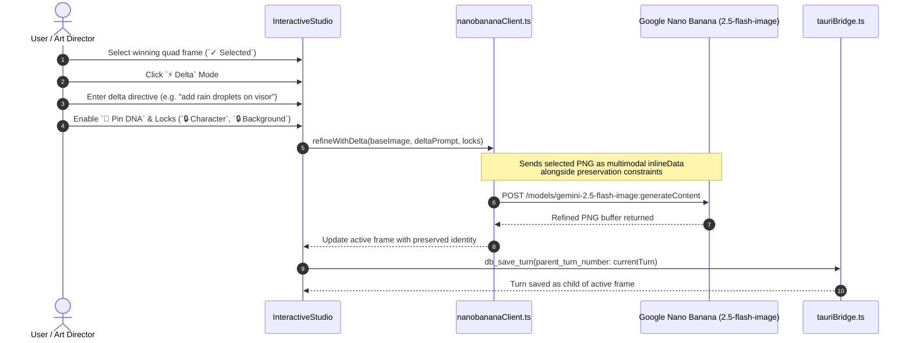
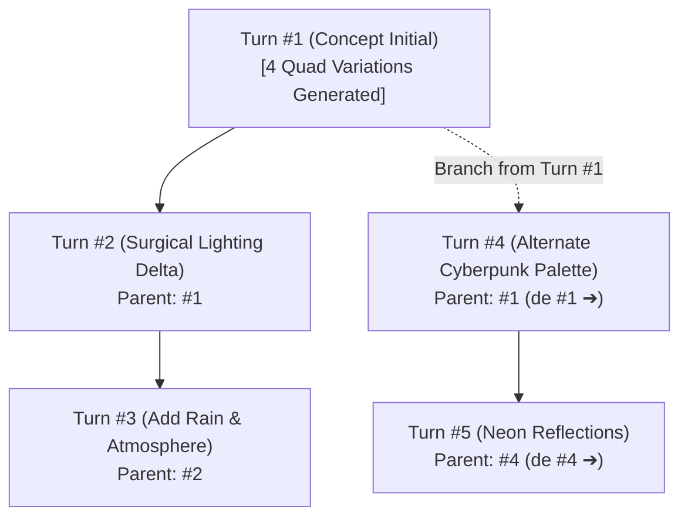
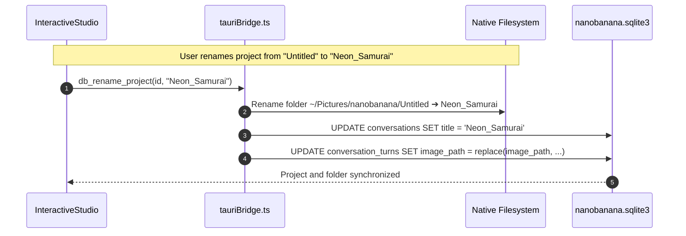
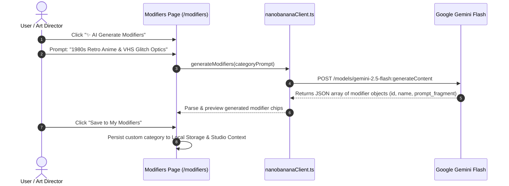

# Processing Pipelines — Nano Banana Atelier Studio 🍌✦

This document provides sequence diagrams and step-by-step specifications for all **5 core processing pipelines** in **Nano Banana Atelier Studio**:

1. **Dynamic Scene Expansion & 4-Quad Generation (`1 + 3`)**
2. **Surgical Delta & Dual-Anchor Preservation**
3. **Non-Destructive Branching Timeline & History Resumption**
4. **Local Filesystem Persistence & Folder Synchronization**
5. **Modifiers Studio AI Synthesis**

---

## 1. Dynamic Scene Expansion & 4-Quad Generation (`1 + 3`)

Instead of rendering a single image from a raw prompt, the system queries `gemini-2.5-flash` to evaluate the scene concept and produce 3 artistic variations giving emphasis to complementary visual aspects. All 4 variations are dispatched concurrently to `gemini-2.5-flash-image`.

---

## 2. Surgical Delta & Dual-Anchor Consistency

When iterating on an existing frame, `⚡ Surgical Delta` mode allows creators to apply targeted incremental changes without rewriting the base scene description.

---

## 3. Non-Destructive Branching Timeline & Lineage Resumption

Every iteration records its parent turn (`parent_turn_number`), allowing creators to explore diverging creative directions from any point in the history.

- Clicking any prior turn in the vertical timeline loads its exact prompts, style presets, modifiers, and all 4 quad images.
- Subsequent generations automatically register the selected turn as the parent, creating a new branch indicator (`de #X ➔`) in the timeline.

---

## 4. Local Filesystem Persistence & Folder Synchronization

High-resolution generated images are persisted directly to the operating system's filesystem, categorized by project name.

- If a project is deleted in the UI, SQLite records are removed, but the folder `~/Pictures/nanobanana/<project-name>/` remains preserved on disk to prevent accidental data loss.

---

## 5. Modifiers Studio AI Synthesis

On the `/modifiers` route, creators can curate style, camera, and lighting modifier chips, or leverage Gemini to synthesize entirely new modifier categories.

