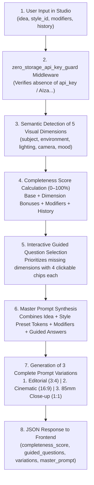
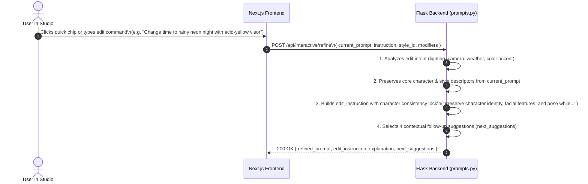
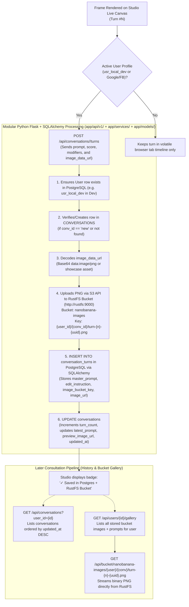
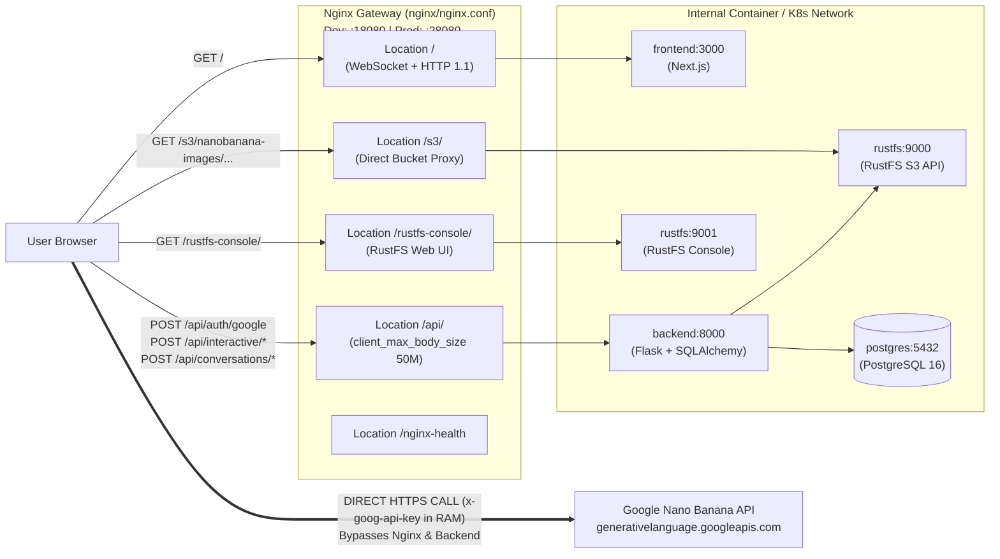

# Processing Pipelines — Nano Banana Studio 🍌✦

This document details the **5 Core Processing Pipelines** that power **Nano Banana Studio**, from incoming reverse-proxy routing at the **Nginx Gateway**, through **Local Dev (`usr_local_dev`) / Google / Facebook OAuth** authentication, heuristic prompt engineering in **Python (Flask + SQLAlchemy)**, direct browser-to-Google image generation via **Nano Banana (`gemini-2.5-flash-image`)** using a volatile RAM key, to transactional persistence in **PostgreSQL 16** and the **RustFS S3 Bucket**.

---

## Pipeline 1: Heuristic Diagnostics & Interactive Prompt Co-Pilot (`POST /api/interactive/analyze`)

This pipeline transforms a brief natural-language idea into a structured, cinema-grade art-direction package.



### Internal Processing Steps (`backend/app/services/copilot_service.py`):
1. **Normalization & Bilingual Lexical Matching**: The user's `idea` and accumulated `history` tokens are evaluated against bilingual (Portuguese/English) visual vocabularies.
2. **Dimensional Assessment**: The engine checks five visual dimensions:
   - `subject` (character details, wardrobe, expression)
   - `environment` (setting, architecture, backdrop)
   - `lighting` (rim light, golden hour, chiaroscuro, neon reflections)
   - `camera` (focal length, depth of field, framing angle)
   - `mood` (atmosphere and color palette)
3. **Heuristic Scoring (`completeness_score`)**: Computes a `0–100%` score reflecting how well-specified the visual direction is.
4. **Master Prompt & Variations Synthesis**: Injects the selected style preset's `prompt_tokens` (e.g., *Editorial Anime Crypko*) and builds 3 distinct variations ready for immediate generation.

---

## Pipeline 2: Conversational Multi-Turn Refinement (`POST /api/interactive/refine`)

Once an initial frame is generated, the user can evolve it across multiple turns while preserving character identity:



---

## Pipeline 3: Direct Browser-to-Google Nano Banana Generation & Editing (`Zero-Storage`)

This is the critical privacy pipeline: generative execution occurs **100% between the user's browser and Google's Gemini API**, never passing through Nginx or the Python backend.

```mermaid
sequenceDiagram
    autonumber
    actor U as User
    participant RAM as React useState (Browser RAM)
    participant NBClient as Browser Client (src/lib/nanobanana.ts)
    participant GoogleAPI as Google Gemini API (gemini-2.5-flash-image)

    U->>NBClient: Clicks "Generate with Nano Banana" (or "Apply Multi-Turn Edit")
    NBClient->>RAM: Reads volatile apiKey from memory
    alt No API Key & Interactive Simulation Mode enabled
        NBClient-->>U: Returns simulated interactive showcase frame (/showcase/step-1..3.png)
    else With Gemini API Key in RAM
        opt Multi-Turn Edit (Turn >= 2 with previous reference frame)
            NBClient->>NBClient: Extracts raw Base64 & mimeType from reference image (inlineData)
        end
        NBClient->>NBClient: Builds payload { contents: [{ parts: [inlineData?, { text: prompt }] }], generationConfig: { responseModalities: ["TEXT", "IMAGE"] } }
        NBClient->>GoogleAPI: POST https://generativelanguage.googleapis.com/v1beta/models/gemini-2.5-flash-image:generateContent\nHeader: x-goog-api-key: <RAM_KEY> | cache: "no-store"
        GoogleAPI-->>NBClient: 200 OK (candidates[0].content.parts -> inlineData.data Base64 PNG)
        NBClient->>NBClient: Converts Base64 into data:image/png;base64,...
        NBClient-->>U: Renders frame on Live Canvas & appends node to Interactive Timeline
    end
```

---

## Pipeline 4: Transactional Persistence (PostgreSQL via SQLAlchemy + RustFS Bucket) & Later Consultation

Whenever a user in the Studio (either auto-provisioned `usr_local_dev` in Local Dev mode when `REQUIRE_AUTH=false`, or authenticated via Google/Facebook when `REQUIRE_AUTH=true`) generates or refines an image, the frontend automatically triggers the persistence pipeline:



---

## Pipeline 5: Nginx Reverse Proxy Gateway Routing (`Port Pad` Dev & Prod)

To unify access across all services without CORS friction or port collisions, an **Nginx (`nginx:1.27-alpine`)** gateway fronts the stack in both **Development (`compose.dev.yaml`, Port Pad `+10000`)** and **Production (`compose.prod.yaml`, Port Pad `+20000`)**:


