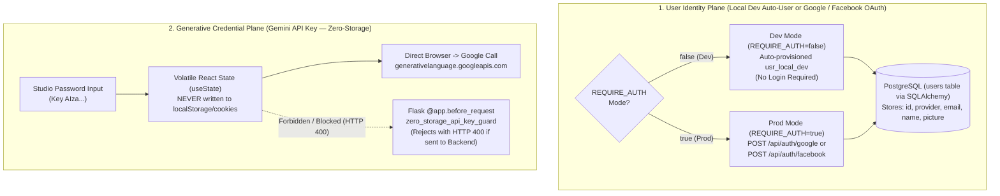

# Zero-Storage Security & Authentication Modes (Local Dev, Google & Facebook) — Nano Banana Studio 🍌✦

This document specifies the security architecture and authentication subsystems of **Nano Banana Studio**:
1. **Zero-Storage Policy for the Google Gemini API Key (`AIza...`)**: Multi-layered technical guarantee ensuring that the user-supplied API key used to invoke **Google Nano Banana (`gemini-2.5-flash-image`)** resides strictly in volatile browser RAM (`React.useState`) and is never written to disk or transmitted to the backend.
2. **Environment-Aware Authentication (`REQUIRE_AUTH=false` in Local Dev vs. `REQUIRE_AUTH=true` in Production)**:
   - **Local / Dev Instance Mode (`compose.dev.yaml` / `compose.yaml`, `REQUIRE_AUTH=false`)**: Login is **not required**. Developers running a local instance enter the Interactive Studio immediately under the auto-provisioned `usr_local_dev` (`Local Dev Instance`) profile in PostgreSQL, with optional Google and Facebook sign-in available in the navbar.
   - **Production Mode (`compose.prod.yaml` & Kubernetes, `REQUIRE_AUTH=true`)**: Enforces **Google OAuth 2.0 (`POST /api/auth/google`)** or **Facebook Login (`POST /api/auth/facebook`)** via the **Flask + SQLAlchemy** backend.

---

## 1. Architectural Separation: User Identity vs. Generative API Key



---

## 2. Zero-Storage API Key Defense-in-Depth

### 2.1 Layer 1 — Volatile RAM Isolation in the Frontend (`frontend/src/`)
1. **Ephemeral React State (`useState`)**: The Gemini API key is stored only in React component memory (`apiKey` state in `InteractiveStudio.tsx` / `page.tsx`).
2. **Zero Web Storage Usage**: **Zero** calls to `window.localStorage`, `window.sessionStorage`, `indexedDB`, or `document.cookie` for the API key.
3. **Direct Browser Fetch with `cache: "no-store"` (`frontend/src/lib/nanobanana.ts`)**: Calls `https://generativelanguage.googleapis.com/v1beta/models/${model}:generateContent` directly from the browser with header `x-goog-api-key: trimmedKey`.
4. **Instant RAM Purge ("Limpar da Memória")**: Clicking the clear button zeroes the React state immediately (`setApiKey("")`).

### 2.2 Layer 2 — Active Flask Guard in the Backend (`zero_storage_api_key_guard`)
In `backend/main.py`, the Flask `@app.before_request` hook (`zero_storage_api_key_guard`) inspects **100% of incoming requests** before any route handler runs and rejects any header, query param, or JSON body field containing `x-goog-api-key`, `api_key`, or `AIza...` patterns with **HTTP `400 Bad Request` (`API_KEY_REJECTED_ZERO_STORAGE`)** without logging or echoing the secret.

---

## 3. Authentication Configuration (`.env.example`)

```dotenv
# Dev vs Prod Auth Requirement
# false = No login required (auto-uses usr_local_dev for local instance convenience)
# true  = Enforces Google or Facebook login before entering Studio
REQUIRE_AUTH=false
NEXT_PUBLIC_REQUIRE_AUTH=false

# Google OAuth 2.0
GOOGLE_CLIENT_ID=your-google-client-id.apps.googleusercontent.com
NEXT_PUBLIC_GOOGLE_CLIENT_ID=your-google-client-id.apps.googleusercontent.com

# Facebook OAuth
FACEBOOK_APP_ID=your-facebook-app-id
NEXT_PUBLIC_FACEBOOK_APP_ID=your-facebook-app-id
```
