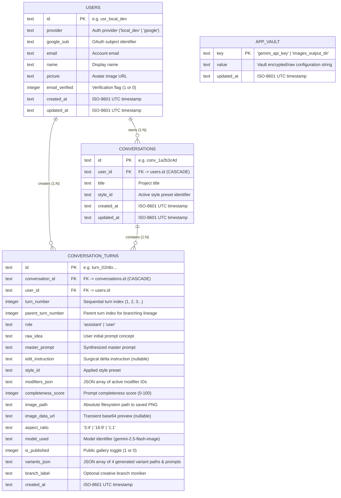

# Local SQLite & Native Filesystem Storage — Nano Banana Atelier Studio 🍌✦

This document specifies the local-first persistence architecture of **Nano Banana Atelier Studio**, covering the **SQLite database schema**, database migration lifecycle, IPC command interfaces, and **native filesystem storage** conventions.

---

## 1. Storage Philosophy: Local-First & Zero-Cloud Dependency

Nano Banana Atelier Studio operates strictly on the user's local hardware:
- **No Cloud Database**: Relational state lives in a single embedded SQLite database file (`nanobanana.sqlite3`) managed via `rusqlite` (in Tauri desktop mode) or Node.js `node:sqlite` (in standalone web dev mode).
- **No S3 / Blob Bucket**: High-resolution image files (`.png`) are stored directly on the operating system's filesystem inside `~/Pictures/nanobanana/<project-name>/`.
- **User Ownership**: Even if a project or iteration is deleted from the application UI, rendered `.png` files remain untouched on the disk.

---

## 2. File & Directory Layout

### Database Path
- **Linux**: `~/.local/share/com.nanobanana.studio/nanobanana.sqlite3`
- **macOS**: `~/Library/Application Support/com.nanobanana.studio/nanobanana.sqlite3`
- **Windows**: `C:\Users\<User>\AppData\Local\com.nanobanana.studio\nanobanana.sqlite3`

### Image Storage Directory
- **Default Directory**: `~/Pictures/nanobanana/<project-name>/`
- **Configurable Location**: Users can customize the output root via the in-app **⚙ Config** modal (`images_output_dir` in `app_vault`).
- **File Naming Convention**:
  - Main turn preview: `<project-name>/turn-<number>.png`
  - Turn variants: `<project-name>/turn-<number>-var-<idx>.png`
  - Canonical format: 24-bit RGB or 32-bit RGBA standard PNG.

---

## 3. Relational Database Schema (`nanobanana.sqlite3`)

The database runs with **Write-Ahead Logging (WAL)** enabled (`PRAGMA journal_mode = WAL;`) and enforced Foreign Key constraints (`PRAGMA foreign_keys = ON;`).



---

## 4. Universal IPC Bridge (`tauriBridge.ts` & `/api/db`)

All frontend components communicate through [`frontend/src/core/tauri/tauriBridge.ts`](file:///usr/local/google/home/vieiravitor/workspace/opensource/nanobanana-inspiration/frontend/src/core/tauri/tauriBridge.ts), which provides transparent fallback:

| Command | Tauri Native (`src-tauri/src/lib.rs`) | Web Dev Route (`/api/db`) | Description |
| :--- | :--- | :--- | :--- |
| `db_init` | `init_database()` | SQLite connection open | Initializes SQLite schema and seeds default developer profile. |
| `db_get_projects` | `get_projects()` | `GET /api/db?action=projects` | Retrieves list of projects with turn count and thumbnail paths. |
| `db_create_project` | `create_project()` | `POST /api/db?action=create_project` | Inserts new conversation container. |
| `db_save_turn` | `save_turn()` | `POST /api/db?action=save_turn` | Saves turn record, variants JSON, and writes PNG to disk. |
| `db_rename_project` | `rename_project()` | `POST /api/db?action=rename_project` | Renames conversation and syncs project folder on disk. |
| `db_delete_project` | `tauri_delete_conversation()` | `POST /api/db (delete_conversation)` | Removes SQLite records (preserves disk folder). |
| `harness_list` | `tauri_list_harness_missions()` | `POST /api/db (list_harness_missions)` | Lists Goal Harness missions ordered by `updated_at DESC`. |
| `harness_get` | `tauri_get_harness_mission()` | `POST /api/db (get_harness_mission)` | Loads full Goal Harness deliverables, rubric, and round trajectory. |
| `harness_save` | `tauri_save_harness_mission()` | `POST /api/db (save_harness_mission)` | Writes candidate & round-versioned incumbent PNGs to disk and upserts `harness_missions`. |
| `harness_rename` | `tauri_update_harness_mission_title()` | `POST /api/db (update_harness_mission_title)` | Atomically updates a Goal Harness mission's title in SQLite. |
| `harness_status` | `tauri_update_harness_mission_status()` | `POST /api/db (update_harness_mission_status)` | Atomically updates mission status (e.g., `stopped`). |
| `vault_get` / `set` | `tauri_vault_*()` | `POST /api/db (vault_*)` | Reads/writes API key, output dir, modifiers, and AI prompts + `harnessDefaultSteps` (`3..10`). |

---

## 5. Filesystem Image Streaming

In the desktop WebView, local filesystem paths are accessed directly via Tauri asset protocols (`asset://` or file URLs).

In web development mode, the local image streaming endpoint ([`/api/image/route.ts`](file:///usr/local/google/home/vieiravitor/workspace/opensource/nanobanana-inspiration/frontend/src/app/api/image/route.ts)) streams requested images securely from disk:

```typescript
// frontend/src/app/api/image/route.ts
const filePath = req.nextUrl.searchParams.get("path");
const fileBuffer = fs.readFileSync(resolvedPath);
return new NextResponse(fileBuffer, {
  headers: { "Content-Type": "image/png", "Cache-Control": "public, max-age=31536000, immutable" },
});
```
